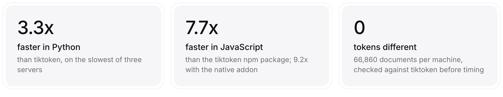
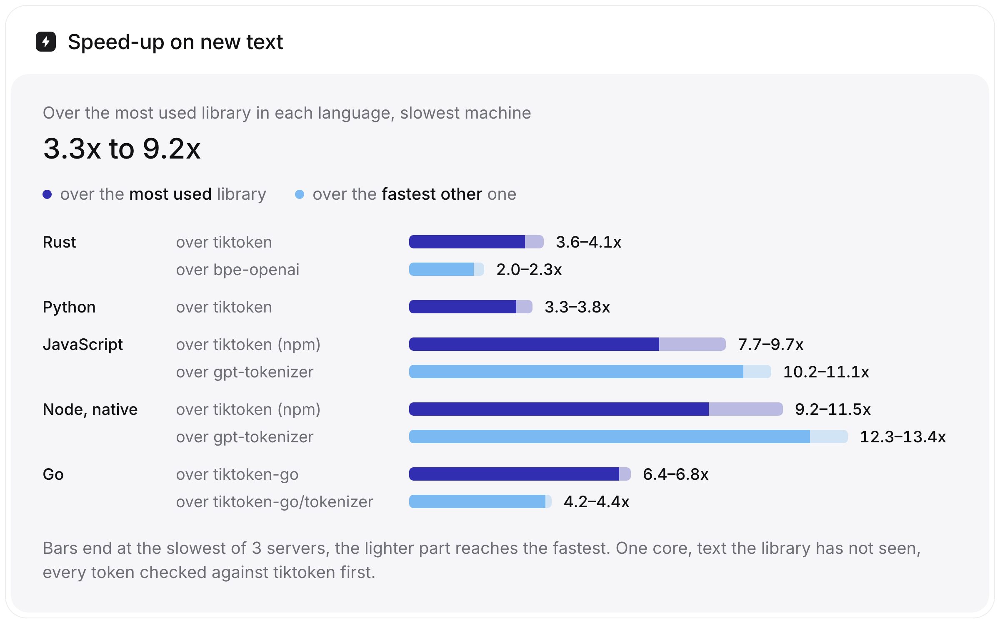
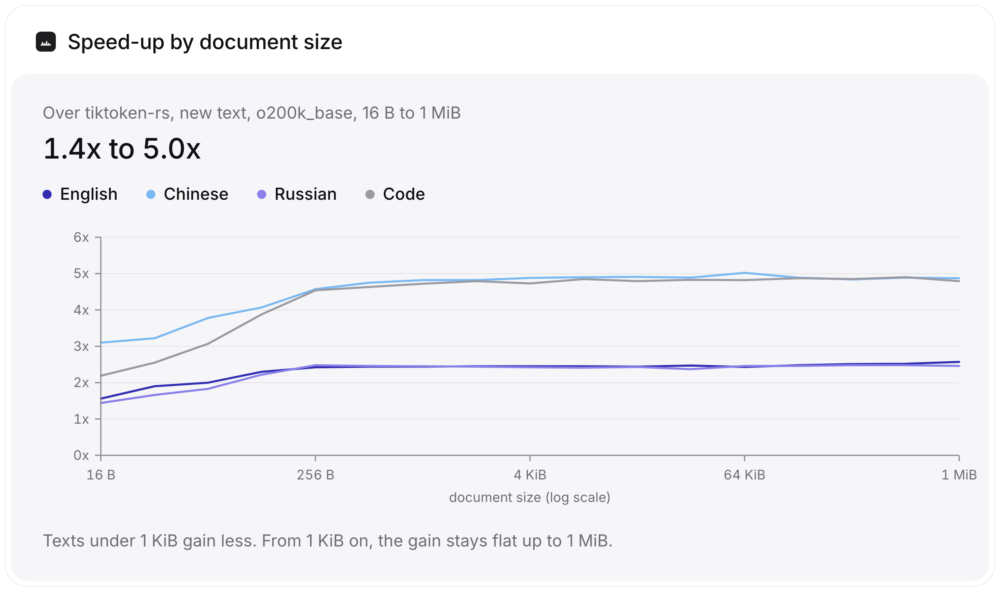

<div align="center">

# tiktoken-fast

**OpenAI's tokenizer with the same token ids, several times faster**

[](https://github.com/s3bastiankoch/tiktoken-fast/actions/workflows/ci.yml)
[](LICENSE)
[](src)
[](python)
[](js)
[](go)

</div>

A drop-in replacement for tiktoken that returns the same token ids, several times faster. One Rust core serves Rust, Python and JavaScript; Go gets a separate port. In Python and Go, switching is a changed import; in JavaScript, for the common calls.

Every number below is for text the library has not seen before, measured on Intel, AMD and ARM servers against the most used library in each language and the fastest other one, with every result checked token for token before it was timed. One script makes all of them; [how, and how to rerun it](docs/benchmarks.md).

<picture>
  <source media="(prefers-color-scheme: dark)" srcset="docs/img/headline-dark.png">
  
</picture>

<picture>
  <source media="(prefers-color-scheme: dark)" srcset="docs/img/languages-dark.png">
  
</picture>

Encodings: `o200k_base` (GPT-4o, GPT-4.1, GPT-5, o-series), `cl100k_base`
(GPT-4, GPT-3.5, embeddings), `p50k_base`, `p50k_edit`, `r50k_base`.

## Use it

<table>
<tr>
<th>Python</th>
<th>JavaScript</th>
</tr>
<tr>
<td>

```python
import tiktoken_fast as tiktoken

enc = tiktoken.get_encoding("o200k_base")
enc.encode("hello world")      # [24912, 2375]
enc.count_tokens(long_text)    # without the list
```

</td>
<td>

```js
const { get_encoding } = require("tiktoken-fast");

const enc = get_encoding("o200k_base");
enc.encode("hello world");     // Uint32Array [24912, 2375]
enc.count(longText);           // without the array
```

</td>
</tr>
<tr>
<th>Rust</th>
<th>Go</th>
</tr>
<tr>
<td>

```rust
let enc = tiktoken_fast::o200k_base()?;
let ids = enc.encode_ordinary("hello world");
assert_eq!(ids, [24912, 2375]);
```

</td>
<td>

```go
enc, _ := tiktoken.GetEncoding("o200k_base")
ids := enc.Encode("hello world", nil, nil)
// [24912 2375]
```

</td>
</tr>
</table>

The Python, JavaScript and Go packages keep the API of the library they
replace, so switching is a changed import: `tiktoken` in Python (or
`tiktoken_fast.patch()` for code that imports tiktoken itself), the `tiktoken`
npm package in JavaScript (`get_encoding`, `encoding_for_model`, `encode`,
`encode_ordinary`, `decode`, `free`; not yet `encode_with_unstable`,
`encode_single_token`, `decode_single_token_bytes`, `token_byte_values` or the
`tiktoken/lite` entry point), and `pkoukk/tiktoken-go` in Go. The Rust crate has
an API of its own, modelled on tiktoken's core (`encode_ordinary`, `encode`,
`decode_bytes`); it is not a drop-in for tiktoken-rs.

```sh
pip install tiktoken-fast
npm install tiktoken-fast
cargo add tiktoken-fast
go get github.com/s3bastiankoch/tiktoken-fast/go
```

| | Directory | Replaces | Built from |
|---|---|---|---|
| Rust | [`src/`](src) | (own API, after tiktoken's core) | the core |
| Python | [`python/`](python) | `tiktoken` | the core, through PyO3 |
| JavaScript | [`js/`](js) | `tiktoken` (npm) | the core, as WebAssembly |
| Node | [`node/`](node) | `tiktoken` (npm) | the core, as a native addon; build from source, not on npm yet |
| Go | [`go/`](go) | `pkoukk/tiktoken-go` | a separate pure Go port |

## Numbers

One core each on three cloud servers, same script, code and input files.
Each figure is the geometric mean over 32 rows: Wikipedia in eleven
languages, 512-byte chat messages, source code and two books, in
`cl100k_base` and `o200k_base`, all text the library has not seen before.

| | over | Intel<br><sub>Xeon 8481C</sub> | AMD<br><sub>EPYC 9B14</sub> | ARM<br><sub>Google Axion</sub> |
|---|---|---:|---:|---:|
| **Rust** | tiktoken | **3.55x** | **4.13x** | **3.69x** |
| | bpe-openai | 1.98x | 2.30x | 2.30x |
| **Python** | tiktoken | **3.28x** | **3.78x** | **3.50x** |
| **JavaScript** | tiktoken (npm) | **7.66x** | **9.71x** | **8.76x** |
| | gpt-tokenizer | 10.24x | 10.56x | 11.09x |
| | js-tiktoken | 54.4x | 56.6x | 54.4x |
| **Node, native²** | tiktoken (npm) | **9.19x** | **11.46x** | **10.62x** |
| | gpt-tokenizer | 12.28x | 12.46x | 13.44x |
| **Go** | tiktoken-go | **6.44x** | **6.80x** | **6.72x** |
| | tiktoken-go/tokenizer¹ | 4.37x | 4.29x | 4.17x |

<p align="center">
<b>66 860</b> documents checked per machine &nbsp;·&nbsp;
<b>0</b> with different tokens &nbsp;·&nbsp;
<b>0</b> of 2 532 rows slower
</p>

<sub>95% intervals are within ±2.5% of every figure; they and every row are in the
summaries for [Intel](bench/results/2026-10-26-c3-standard-4-a70b9ff/summary.md),
[AMD](bench/results/2026-10-27-c3d-standard-4-3f3699c/summary.md) and
[ARM](bench/results/2026-10-27-c4a-standard-4-3f3699c/summary.md).
The closest row is a tie: re-encoding the same chat messages on ARM,
gpt-tokenizer's cache matches ours (1.02x, interval 0.90–1.10).
¹ differs from tiktoken on 599 documents; timed anyway.
² the native addon builds from source in [`node/`](node); `npm install tiktoken-fast` gets the WebAssembly build.</sub>

<details>
<summary><b>Fresh caches, repeated text and the slowest row</b> (Intel)</summary>
<br>

*New text* keeps caches across documents, as a server does; *fresh caches*
empties them before every document; *same text* encodes it again. Libraries
with caches of their own get the same treatment.

| | over | new text | fresh caches | same text | slowest row |
|---|---|---:|---:|---:|---:|
| **Rust** | tiktoken | 3.55x | 2.86x | 6.32x | 1.70x |
| | bpe-openai | 1.98x | 1.57x | 3.49x | 1.13x |
| **Python** | tiktoken | 3.28x | 2.72x | | 1.80x |
| **JavaScript** | tiktoken (npm) | 7.66x | 6.37x | 11.87x | 4.64x |
| | gpt-tokenizer | 10.24x | 11.44x | 3.13x | 3.37x |
| **Node, native** | tiktoken (npm) | 9.19x | 7.23x | 14.56x | 5.27x |
| | gpt-tokenizer | 12.28x | 12.97x | 3.84x | 5.12x |
| **Go** | tiktoken-go | 6.44x | | | 2.69x |

</details>

<details>
<summary><b>Why these numbers hold up</b></summary>
<br>

- **One script.** [`bench/reproduce.sh`](bench/reproduce.sh) builds, checks
  and times all four languages in about two hours (`QUICK=1`: fifteen
  minutes). It ran unchanged on all three machines.
- **Raw data.** Every round is kept in `raw/*.jsonl`;
  [`bench/summarize.py`](bench/summarize.py) builds every table and the chart
  from it.
- **Same inputs.** Input files are checked against
  [`workloads.sha256`](bench/data/workloads.sha256) before a run.
- **Default builds.** No `target-cpu=native`, versions pinned by lockfiles.
  (The two older runs folded below, seven inputs and document size, are
  labelled as such.)
- **Paired rounds.** Libraries alternate in a rotating order within each of
  11 rounds; the hypervisor stole 0.0% CPU time on every machine.

[`docs/benchmarks.md`](docs/benchmarks.md) has the full method.

</details>

<details>
<summary><b>gpt-tokenizer's own benchmark</b>, seven inputs over and over</summary>
<br>

Rebuilt from its published method in [`js/bench/seven.mjs`](js/bench/seven.mjs);
`o200k_base`, mean ms per call, lower is better. Two older runs on one Xeon
8481C core, 2026-10-27: the WebAssembly rows from
[`2026-10-27-final`](bench/results/2026-10-27-final), the native addon from
[`2026-10-27-native`](bench/results/2026-10-27-native), built with
`target-cpu=native`. On chat-sized new text the addon gains less over
WebAssembly than here, about 1.2x.

| | encode | count | decode | load |
|---|---:|---:|---:|---:|
| tiktoken-fast, native addon | **0.56** | **0.45** | **0.65** | **50** |
| tiktoken-fast, WebAssembly | 1.00 | 0.87 | 0.67 | 143 |
| gpt-tokenizer 4.1.0 | 7.28 | 5.34 | 0.95 | 152 |
| bpe-lite 0.5.2 | 6.24 | 4.72 | 2.85 | 642 |
| tiktoken 1.0.22 (npm) | 27.80 | 27.77 | 1.34 | 322 |

</details>

<details>
<summary><b>Speed-up by document size</b>, 16 B to 1 MiB</summary>
<br>
<picture>
  <source media="(prefers-color-scheme: dark)" srcset="docs/img/sizes-dark.png">
  
</picture>

An older run (2026-10-26, one Xeon 8481C core, built with `target-cpu=native`,
[`2026-10-26-sizes`](bench/results/2026-10-26-sizes)), over tiktoken's Rust core.

In Python short texts gain the most, because tiktoken spends most of a short
call in the interpreter: batches of 16-byte strings are 20x faster with 8
threads on 4 vCPUs.

</details>

To check the headline on your own machine in fifteen seconds:

```sh
python -m tiktoken_fast.bench     # on standard-library text, or --file yours
```

## Same ids, checked

The only acceptable output is the reference's. tiktoken-fast is checked
against tiktoken itself in every language it ships in:

- Rust: six real corpora, adversarial and random mixed-script strings,
  special tokens and decoding in every encoding; every string of up to five
  units over one representative of each character class the patterns
  distinguish (561 million strings per encoding); a randomised soak on all
  cores with caches dropped at random; a libFuzzer differential target.
- Python and JavaScript: every public method against `tiktoken` and the
  `tiktoken` npm package, including batches, special-token errors, pickling
  and numpy.
- Go: byte-identical output against the fork point on every workload.
- Every benchmark compares every document's tokens before it times anything.

CI runs the Rust tests on Linux and macOS (the exhaustive check up to three
units), the Python and Node addon tests on Linux, macOS and Windows, and the
WebAssembly and Go tests on Linux. The five-unit run and the fuzzer run by
hand. The fuzzer found two bugs in the `o200k_base` scanner early on; both
are fixed and kept as regression tests.

## How

tiktoken splits text with a regex, then merges each piece in a loop that
rescans the piece after every merge. tiktoken-fast gets the same ids with hand-written
scanners instead of the regex, a memo for text it has seen, and cuts where
no token can cross, so little merging is left.
[`docs/design.md`](docs/design.md) has the details.

## Costs and limits

- Building an `o200k_base` encoder takes about 46 ms on an Apple M-series
  laptop (`cl100k_base` 26 ms); tiktoken's core takes about 90 ms and 44 ms
  ([`examples/loadtime.rs`](examples/loadtime.rs)). The tables for
  backtracking wait until a process has merged 1 MiB of non-ASCII pieces.
- Peak memory of a process that encodes one English article is 27 MB with
  `o200k_base` (tiktoken's core 52 MB, bpe-openai 69 MB); with 3.6 MB of Thai
  and Russian it is 57 MB (56 MB, 76 MB). Measured with
  [`bench/mem`](bench/mem) on the same laptop.
- One long word, such as a megabyte of a single letter, is 10 to 15% slower
  than in tiktoken: there are no repeats to memoise and the merge is the same
  kind of loop.
- In Python, building an `o200k_base` encoder takes about 120 ms against
  tiktoken's 77 ms (M-series laptop).
- Each thread that encodes at the same time keeps its own caches (up to 64
  sets), so wide thread pools use more memory: `encode_batch` with 64 threads
  peaked at 504 MB against tiktoken's 308 MB.
- The Go port is a separate implementation and gains less on Chinese,
  Japanese and Korean than the Rust core does.
- The full benchmark has run on Intel, AMD and ARM cloud servers; Apple
  silicon has an earlier, partial run. Gains differ by up to 1.27x between
  machines.

## Acknowledgements

The vocabularies under `assets/` are OpenAI's, copied from the tiktoken-rs
crate (MIT). The backtracking encoder follows GitHub's
[bpe](https://github.com/github/rust-gems/tree/main/crates/bpe) crate (MIT).
The Go port is a fork of [pkoukk/tiktoken-go](https://github.com/pkoukk/tiktoken-go)
(MIT). See [`NOTICE`](NOTICE).

## License

[MIT](LICENSE). The vocabularies are OpenAI's, see [`NOTICE`](NOTICE).

<sub>Not affiliated with OpenAI.</sub>
